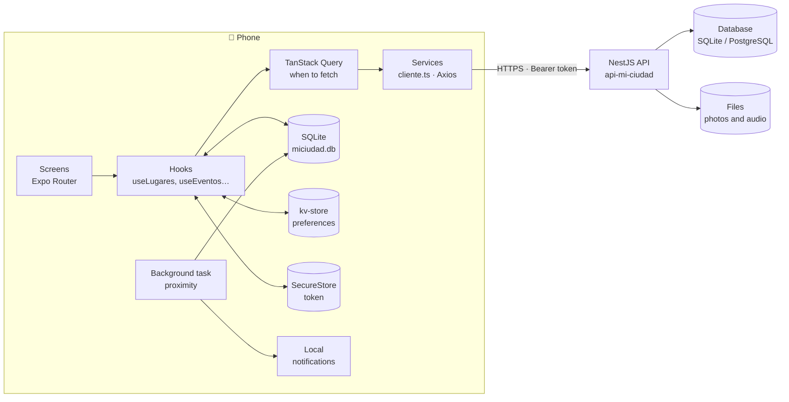
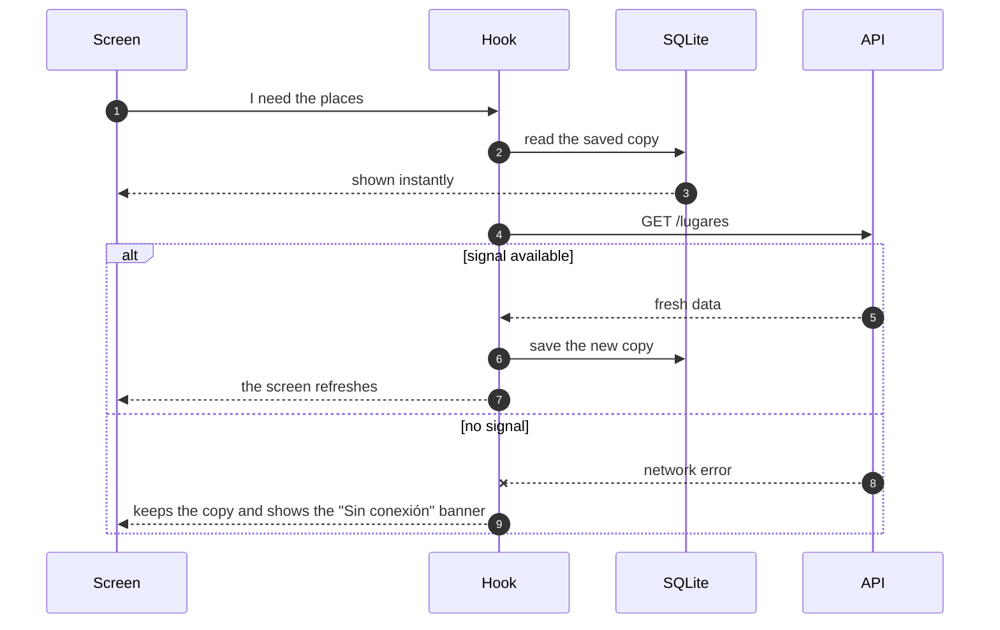
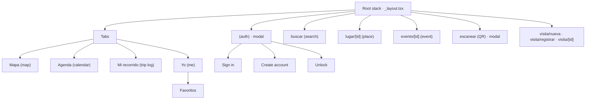

# Mi Ciudad Colón: overview

A phone tour guide for Colón (Entre Ríos, Argentina). Final project 2026 for Mobile Development, Web Development degree (UNER).

The app shows places on a map, the city's events calendar, your trip log (the visits you registered) and audio guides. It is meant to be used **while walking around the city**, so almost everything works **without signal**: whatever was last seen stays saved on the phone.

## What is in the repo

| Folder | What it is |
|---|---|
| `MiCiudad/` | The app: Expo SDK 57, React Native, TypeScript. |
| `api-mi-ciudad/` | The course API: NestJS, with SQLite, PostgreSQL, MySQL or MariaDB. |
| `playbook/` | The menu that starts everything on Windows or Linux. |
| `docs/` | This documentation. |

## The four team parts

Every app file starts with a `Dueño:` (owner) comment saying which part it belongs to.

| Part | What it covers | Main folders |
|---|---|---|
| **A · Account and platform** | Sign in, sign up, session, fingerprint, favorites, preferences, theme, notifications, offline banner | `cuenta/`, `compartido/`, `app/(auth)/`, `app/(tabs)/yo/` |
| **B · Places and data** | Places and categories catalog, place detail, opening hours, the SQLite database, the HTTP client and the types | `lugares/`, `compartido/db.ts`, `servicios/cliente.ts`, `tipos/` |
| **C · Map and calendar** | Map, location, compass, directions, proximity notice, events calendar and "Avisarme" (remind me) | `mapa/`, `eventos/`, `app/(tabs)/index.tsx`, `app/(tabs)/agenda.tsx` |
| **D · Trip log and audio guides** | Registering visits (QR, GPS or by hand, with a photo), the queue that uploads them when offline, and audio guides | `recorrido/`, `audioguias/`, `app/visita/`, `app/escanear.tsx` |

## Architecture

Screens never talk to the API directly. There are three layers, each with a single job:

1. **Screens** (`src/app/`, Expo Router): draw things and react to taps.
2. **Hooks** (`useLugares`, `useEventos`, `useRegistrarVisita`…): decide where each piece of data comes from. They show what is saved on the phone first and then refresh from the server.
3. **Services** (`src/servicios/`): one function per HTTP request. All of them go through `cliente.ts`, which adds the token and translates errors.

### Where each thing is stored on the phone

| Where | What it stores | Why there |
|---|---|---|
| **SQLite** (`miciudad.db`) | Places, categories, events, favorites, saved events, visits | Lists that get queried and filtered. This is the copy used offline. |
| **kv-store** | Preferences (theme, proximity notice and its radius), notices already shown, visit draft | Small standalone values. |
| **SecureStore** | The session token | It is a secret: encrypted, never in kv-store. |
| **Disk** (expo-file-system) | Visit photos and downloaded audio guides | They are files. Kept as a local copy so they are not lost. |

### The "phone first, server second" pattern

Every list (places, events, favorites, visits) follows the same path. That is why the app opens instantly and copes without signal:

## Navigation

Browsing the map, places and calendar **does not need an account**. An account is needed to save things: favorites, events with a reminder and visits.

## Technologies

| What for | Library |
|---|---|
| Base | Expo SDK 57, React Native, TypeScript |
| Navigation | `expo-router` (file-based routes) |
| Server data | `@tanstack/react-query` + `axios` |
| Data on the phone | `expo-sqlite` (and its `kv-store`), `expo-secure-store`, `expo-file-system` |
| Map and location | `react-native-maps`, `expo-location`, `expo-task-manager` (background notice) |
| Notifications | `expo-notifications` (local) |
| Network | `expo-network` ("Sin conexión" banner) |
| Camera and photos | `expo-camera` (QR), `expo-image-picker`, `expo-image-manipulator` |
| Audio | `expo-audio` |
| Sensors | `expo-sensors` (compass), `expo-haptics` |
| Fingerprint | `expo-local-authentication` |
| Building | Gradle with JDK 17; test APK with EAS (`preview` profile) |
