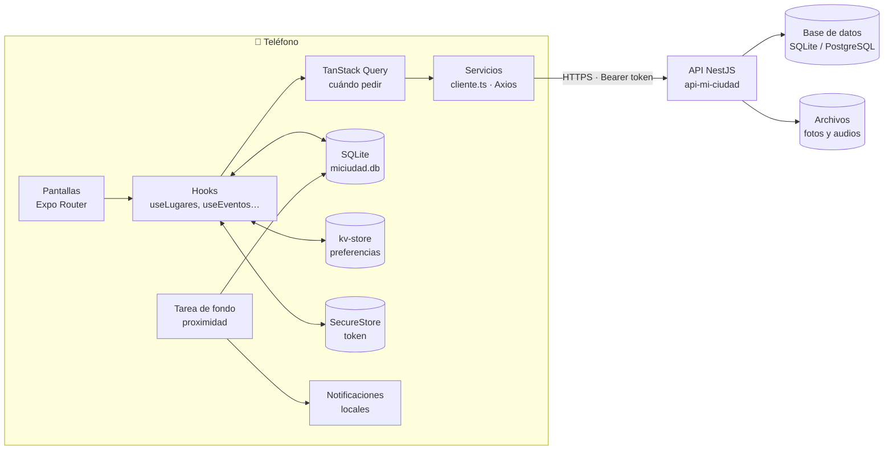
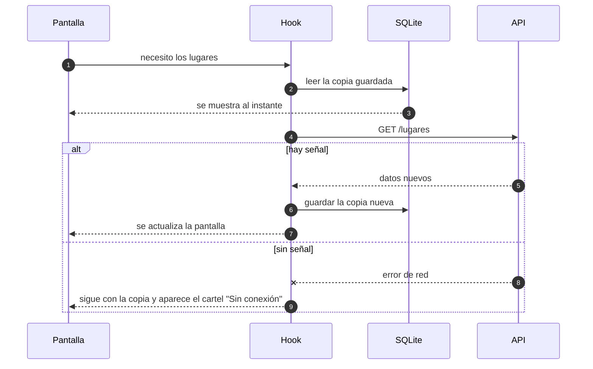
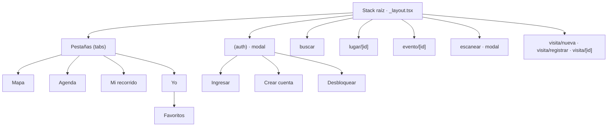

# Mi Ciudad Colón: visión general

Guía turística de Colón (Entre Ríos) para el celular. Trabajo Final Integrador 2026 de Desarrollo para Móviles, Tecnicatura en Desarrollo Web (UNER).

La app muestra los lugares en un mapa, la agenda de eventos de la ciudad, tu recorrido (las visitas que registraste) y audioguías. Está pensada para usarse **caminando por la ciudad**, así que casi todo funciona **sin señal**: lo último que se vio queda guardado en el teléfono.

## Qué hay en el repo

| Carpeta | Qué es |
|---|---|
| `MiCiudad/` | La app: Expo SDK 57, React Native, TypeScript. |
| `api-mi-ciudad/` | La API de la cátedra: NestJS, con SQLite, PostgreSQL, MySQL o MariaDB. |
| `playbook/` | El menú para levantar todo en Windows o Linux. |
| `docs/` | Esta documentación. |

## Las cuatro partes del equipo

Cada archivo de la app empieza con un comentario `Dueño:` que dice de qué parte es.

| Parte | Qué cubre | Carpetas principales |
|---|---|---|
| **A · Cuenta y plataforma** | Ingreso, registro, sesión, huella, favoritos, preferencias, tema, avisos, banner sin conexión | `cuenta/`, `compartido/`, `app/(auth)/`, `app/(tabs)/yo/` |
| **B · Lugares y datos** | Catálogo de lugares y categorías, ficha del lugar, horarios, la base SQLite, el cliente HTTP y los tipos | `lugares/`, `compartido/db.ts`, `servicios/cliente.ts`, `tipos/` |
| **C · Mapa y agenda** | Mapa, ubicación, brújula, cómo llegar, aviso de proximidad, agenda de eventos y "Avisarme" | `mapa/`, `eventos/`, `app/(tabs)/index.tsx`, `app/(tabs)/agenda.tsx` |
| **D · Recorrido y audioguías** | Registrar visitas (QR, GPS o a mano, con foto), la cola que las sube sin señal y las audioguías | `recorrido/`, `audioguias/`, `app/visita/`, `app/escanear.tsx` |

## Arquitectura

La app nunca le habla directo a la API desde una pantalla. Hay tres capas, y cada una tiene una sola tarea:

1. **Pantallas** (`src/app/`, Expo Router): dibujan y reaccionan a toques.
2. **Hooks** (`useLugares`, `useEventos`, `useRegistrarVisita`…): deciden de dónde sale cada dato. Primero muestran lo guardado en el teléfono y después actualizan con el servidor.
3. **Servicios** (`src/servicios/`): una función por pedido HTTP. Todos pasan por `cliente.ts`, que agrega el token y traduce los errores.

### Dónde se guarda cada cosa en el teléfono

| Dónde | Qué guarda | Por qué ahí |
|---|---|---|
| **SQLite** (`miciudad.db`) | Lugares, categorías, eventos, favoritos, eventos guardados, visitas | Son listas que se consultan y se filtran. Es la copia que se usa sin señal. |
| **kv-store** | Preferencias (tema, aviso de proximidad y su radio), avisos ya mostrados, borrador de visita | Son valores sueltos y chicos. |
| **SecureStore** | El token de la sesión | Es un secreto: va cifrado y nunca al kv-store. |
| **Disco** (expo-file-system) | Fotos de las visitas y audioguías descargadas | Son archivos. Se guardan como copia local para que no se pierdan. |

### El patrón "primero el teléfono, después el servidor"

Todas las listas (lugares, eventos, favoritos, visitas) siguen el mismo camino. Por eso la app abre al instante y aguanta la falta de señal:

## Navegación

Mirar el mapa, los lugares y la agenda **no pide cuenta**. La cuenta hace falta para guardar cosas: favoritos, eventos con aviso y visitas.

## Tecnologías

| Para qué | Librería |
|---|---|
| Base | Expo SDK 57, React Native, TypeScript |
| Navegación | `expo-router` (rutas por archivos) |
| Datos del servidor | `@tanstack/react-query` + `axios` |
| Datos en el teléfono | `expo-sqlite` (y su `kv-store`), `expo-secure-store`, `expo-file-system` |
| Mapa y ubicación | `react-native-maps`, `expo-location`, `expo-task-manager` (aviso en segundo plano) |
| Avisos | `expo-notifications` (locales) |
| Red | `expo-network` (banner "Sin conexión") |
| Cámara y fotos | `expo-camera` (QR), `expo-image-picker`, `expo-image-manipulator` |
| Audio | `expo-audio` |
| Sensores | `expo-sensors` (brújula), `expo-haptics` |
| Huella | `expo-local-authentication` |
| Compilar | Gradle con JDK 17; APK de prueba con EAS (perfil `preview`) |
