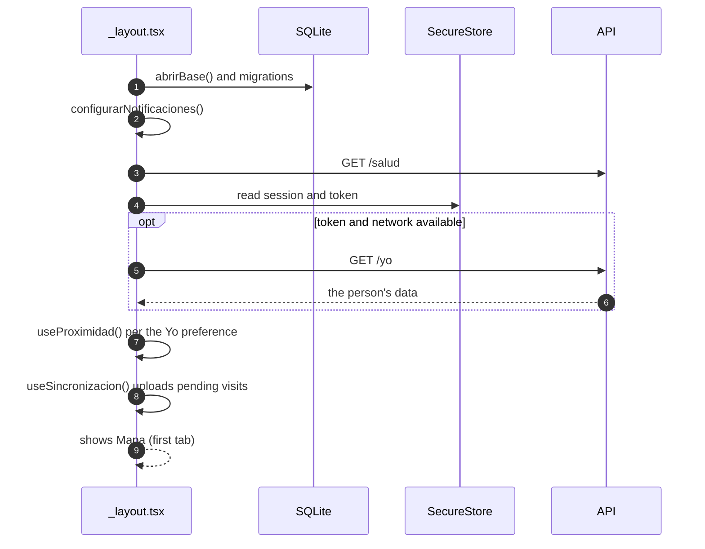
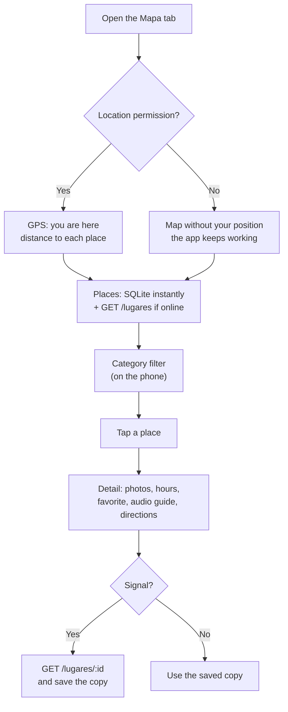
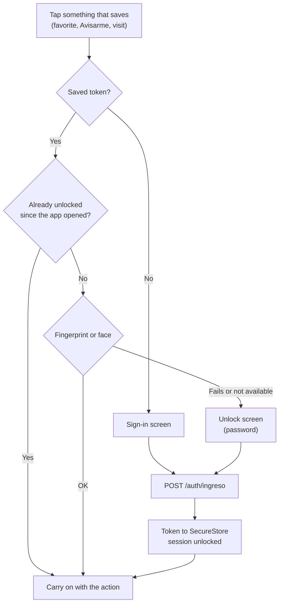
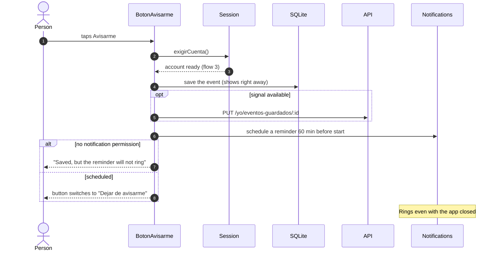
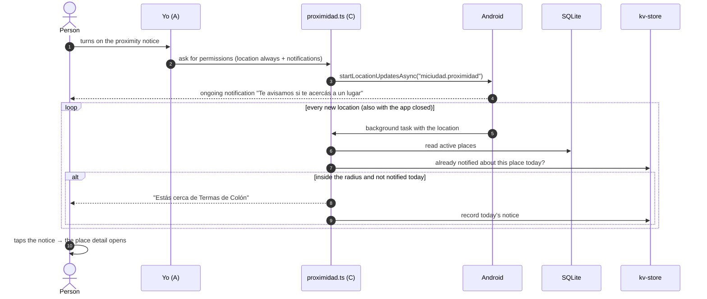
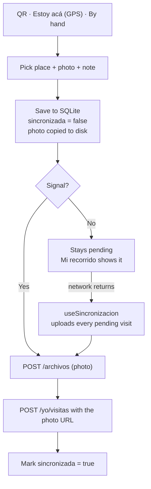

# End-to-end flows

What happens in the app, on the phone and in the API for each thing a person does, and what happens if the signal drops. Each flow says which team part owns it and where the code is.

## 1. Opening the app

**Part A** (with B, C and D) · `app/_layout.tsx`

On launch, the root layout prepares everything before the first screen shows up:

- **Database:** opens the SQLite database and runs the migrations (B).
- **Notifications:** sets up the notification channel (A).
- **API:** pings `/salud` to check that the API is reachable.
- **Session:** restores the saved session (A). The token lives in SecureStore; with network it calls `/yo` to refresh the person's data.
- **Proximity notice:** turns on only if it was on before (C).
- **Visits:** uploads the pending ones when the network comes back (D).

The session **survives closing the app**: no need to type the password again. What is lost on close is the "unlock": the first time something needs the account, the app asks for the fingerprint (see flow 3).

## 2. Map and place detail

**Parts C and B** · `app/(tabs)/index.tsx`, `mapa/useUbicacion.ts`, `lugares/useLugares.ts`, `app/lugar/[id].tsx`

1. **Permission:** the map asks for location permission. If the person denies it, the map keeps working, just without the "you are here" dot.
2. **Places:** read from SQLite (instantly) and then from `GET /lugares` (if online). The list is sorted by distance using the Haversine formula (`compartido/distancia.ts`).
3. **Filters:** the category chips filter on the phone, without asking the server again. "Buscar" opens the full list with a search box.
4. **Detail:** tapping a place opens `lugar/[id]` with photos, opening hours ("Abierto" or "Cerrado" using Colón's local time), favorite (A), audio guide (D) and directions.

## 3. Account: sign in, session and fingerprint

**Part A** · `cuenta/SesionContext.tsx`, `cuenta/biometria.ts`, `app/(auth)/`

Browsing needs no account. When the person wants to **save** something (favorite, Avisarme, visit), the screen calls `exigirCuenta()`:

- **Token:** the token lives **only** in SecureStore, never in kv-store.
- **Signing out:** deletes the token from the phone.
- **Password:** the fallback to the fingerprint needs the API (`POST /auth/ingreso`). Offline and without a fingerprint, the account cannot be unlocked.

## 4. Calendar and "Avisarme" (remind me)

**Part C** · `app/(tabs)/agenda.tsx`, `eventos/useEventos.ts`, `eventos/useEventoGuardado.ts`, `eventos/recordatorios.ts`

**The calendar** follows the usual pattern: SQLite first, then `GET /eventos`. It groups by day ("Hoy", "Mañana"…) using Colón's time, even if the phone is in another time zone. Every time fresh events arrive online, `revisarCambiosDeEstado` compares them with the previous copy: if an event the person saved became **suspended** or **cancelled**, it cancels its reminder and notifies them.

**"Avisarme"** on an event detail:

- **Offline:** the event stays saved on the phone. The next time it is fetched online (opening the event or Yo), `sincronizarEventosGuardados` uploads what is pending and removes from the account what was removed here: the phone wins.
- **New phone:** if the account never synced on that phone, it copies the account's saved events.

## 5. Proximity notice

**Part C** (the preference is stored by A in Yo) · `mapa/proximidad.ts`

The person turns on **"Avisarme cuando esté cerca"** (notify me when near) in Yo. From then on, a **background task** receives the location even with the app closed:

- **One notice per place per day.** The person picks the radius in Yo.
- **Places offline:** it reads places from SQLite, so it works without signal.
- **No permission:** if the person denies "always" location permission, the app keeps working, but the notice does not turn on.
- **Turning it off:** stops the background task (`stopLocationUpdatesAsync`) and removes the ongoing notification.

## 6. Registering a visit

**Part D** · `recorrido/useRegistrarVisita.ts`, `recorrido/colaVisitas.ts`, `app/escanear.tsx`, `app/visita/`

There are three ways to say "I was here":

- **QR:** scans the place's sign and looks the place up with `GET /lugares/qr/:codigo`.
- **"Estoy acá" (I'm here):** uses GPS and suggests places within 100 m.
- **By hand:** pick the place from the list.

A photo (camera or gallery) and a note can be added. The visit **is saved on the phone first**, marked as pending:

On a new phone, `traerVisitasDeLaCuenta` downloads the visits the account already had.

## 7. Audio guides

**Part D** · `audioguias/descargas.ts`, `audioguias/useAudioguia.ts`

When a place detail opens online, its audio guide is **downloaded to disk** (`expo-file-system`). It plays with `expo-audio`, with play, pause and skip forward. Offline, it plays from that copy. A place without an audio guide shows a clear message, not a blank space.

## 8. Offline

**Part A** (the banner) and every part (the data) · `compartido/useRed.ts`, `compartido/componentes/BannerSinConexion.tsx`

```mermaid
stateDiagram-v2
  [*] --> Online
  Online --> Offline: signal drops
  Offline --> Online: signal returns
  state Online {
    [*] --> Fetch
    Fetch: asks the API and keeps a copy in SQLite
  }
  state Offline {
    [*] --> Local
    Local: "Sin conexión" banner, everything comes from SQLite
    Local --> Pending: save a favorite, event or visit
    Pending: stays on the phone marked as pending
  }
  Offline --> Sync: when the network returns
  Sync: visits upload on their own; favorites and events when fetched
  Sync --> Online
```

| Offline… | What happens |
|---|---|
| Map, places and details | Come from the saved copy. |
| Calendar and event detail | Come from the saved copy. |
| Audio guides | Play if they were downloaded before. |
| Saving a favorite, Avisarme or a visit | Saved on the phone. Visits upload on their own when the network returns; favorites and saved events the next time they are fetched online. |
| Signing in for the first time or unlocking with the password | Needs signal. |
