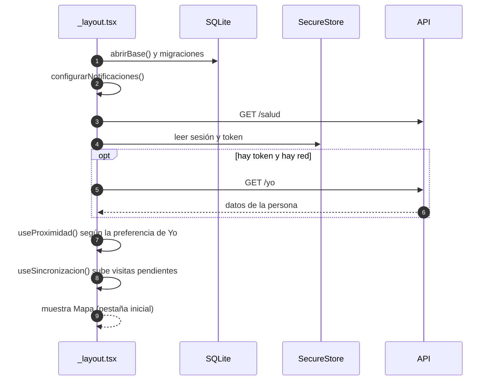
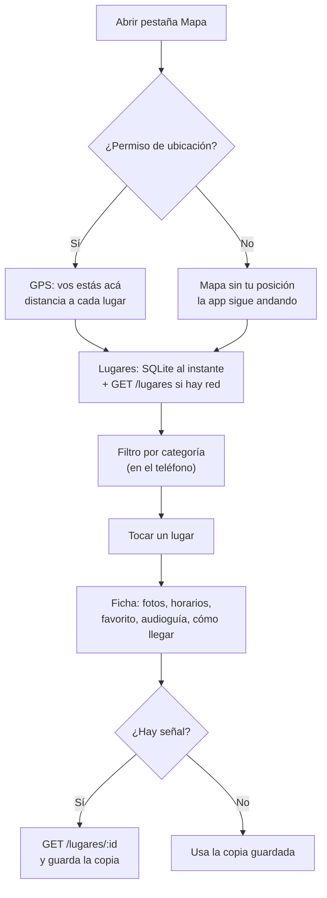
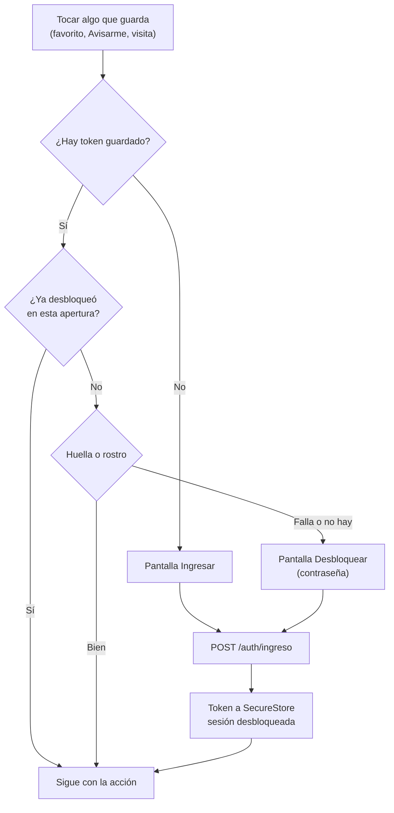
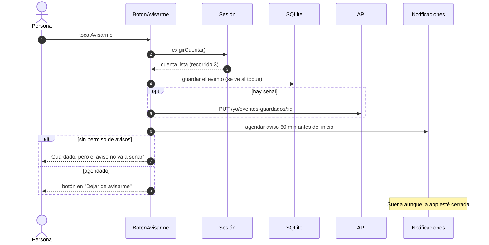
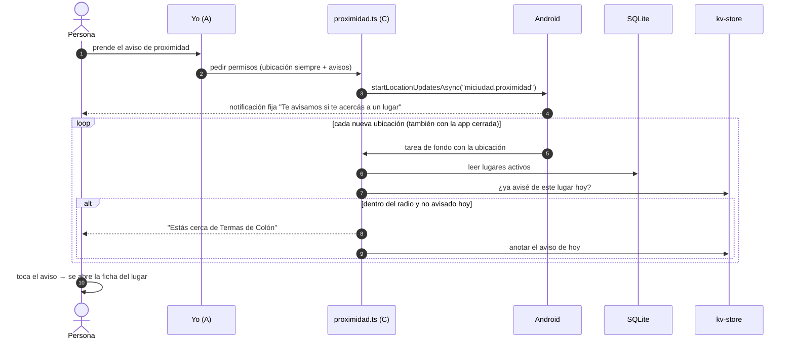
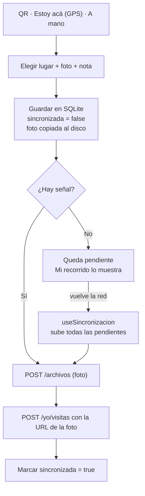

# Recorridos de punta a punta

Qué pasa en la app, en el teléfono y en la API en cada cosa que hace una persona, y qué pasa si se corta la señal. Cada recorrido dice qué parte del equipo lo tiene y dónde está el código.

## 1. Abrir la app

**Parte A** (con B, C y D) · `app/_layout.tsx`

Al abrir, el layout raíz prepara todo antes de mostrar la primera pantalla:

- **Base:** abre la base SQLite y aplica las migraciones (B).
- **Avisos:** configura el canal de avisos (A).
- **API:** hace un "ping" a `/salud` para saber si llega a la API.
- **Sesión:** recupera la sesión guardada (A). El token está en SecureStore; si hay red, pide `/yo` para actualizar los datos de la persona.
- **Aviso de proximidad:** se prende solo si estaba prendido (C).
- **Visitas:** sube las que quedaron pendientes cuando vuelve la red (D).

La sesión **sobrevive al cierre**: no hace falta volver a escribir la contraseña. Lo que se pierde al cerrar la app es el "desbloqueo": la primera vez que algo pide cuenta, la app pide la huella (ver el recorrido 3).

## 2. Mapa y ficha de un lugar

**Partes C y B** · `app/(tabs)/index.tsx`, `mapa/useUbicacion.ts`, `lugares/useLugares.ts`, `app/lugar/[id].tsx`

1. **Permiso:** el mapa pide permiso de ubicación. Si la persona lo niega, el mapa sigue andando, pero sin el punto de "vos estás acá".
2. **Lugares:** se leen de SQLite (al instante) y después de `GET /lugares` (si hay red). La lista se ordena por distancia con la fórmula de Haversine (`compartido/distancia.ts`).
3. **Filtros:** los chips de categoría filtran en el teléfono, sin volver a pedir al servidor. "Buscar" abre la lista completa con buscador.
4. **Ficha:** al tocar un lugar se abre `lugar/[id]` con fotos, horarios ("Abierto" o "Cerrado" según la hora de Colón), favorito (A), audioguía (D) y "Cómo llegar".

## 3. Cuenta: ingresar, sesión y huella

**Parte A** · `cuenta/SesionContext.tsx`, `cuenta/biometria.ts`, `app/(auth)/`

Mirar no pide cuenta. Cuando la persona quiere **guardar** algo (favorito, Avisarme, visita), la pantalla llama a `exigirCuenta()`:

- **Token:** el token vive **solo** en SecureStore, nunca en el kv-store.
- **Cerrar sesión:** borra el token del teléfono.
- **Contraseña:** la alternativa a la huella necesita la API (`POST /auth/ingreso`). Sin señal y sin huella, no se puede desbloquear.

## 4. Agenda y "Avisarme"

**Parte C** · `app/(tabs)/agenda.tsx`, `eventos/useEventos.ts`, `eventos/useEventoGuardado.ts`, `eventos/recordatorios.ts`

**La agenda** sigue el patrón de siempre: SQLite primero, después `GET /eventos`. Agrupa por día ("Hoy", "Mañana"…) con la hora de Colón, aunque el teléfono esté en otra zona horaria. Cada vez que llegan eventos nuevos con red, `revisarCambiosDeEstado` compara con la copia anterior: si un evento que la persona guardó pasó a **suspendido** o **cancelado**, cancela su recordatorio y le avisa.

**"Avisarme"** en el detalle de un evento:

- **Sin señal:** el evento queda guardado en el teléfono. La próxima vez que se consulta con señal (al abrir el evento o Yo), `sincronizarEventosGuardados` sube lo pendiente y quita de la cuenta lo que se quitó acá: el teléfono manda.
- **Teléfono nuevo:** si la cuenta nunca se sincronizó en ese teléfono, copia los eventos guardados de la cuenta.

## 5. Aviso de proximidad

**Parte C** (la preferencia la guarda A en Yo) · `mapa/proximidad.ts`

La persona prende **"Avisarme cuando esté cerca"** en Yo. Desde ese momento, una **tarea de fondo** recibe la ubicación aunque la app esté cerrada:

- **Un aviso por lugar y por día.** El radio lo elige la persona en Yo.
- **Lugares sin red:** lee los lugares de SQLite, así que funciona sin señal.
- **Sin permiso:** si la persona niega el permiso de ubicación "siempre", la app sigue andando, pero el aviso no se prende.
- **Al apagarlo:** se frena la tarea de fondo (`stopLocationUpdatesAsync`) y se va la notificación fija.

## 6. Registrar una visita

**Parte D** · `recorrido/useRegistrarVisita.ts`, `recorrido/colaVisitas.ts`, `app/escanear.tsx`, `app/visita/`

Hay tres formas de decir "estuve acá":

- **QR:** escanea el cartel del lugar y busca el lugar con `GET /lugares/qr/:codigo`.
- **"Estoy acá":** usa el GPS y propone los lugares a menos de 100 m.
- **A mano:** se elige el lugar de la lista.

Se puede sumar una foto (cámara o galería) y una nota. La visita **se guarda primero en el teléfono**, marcada como pendiente:

En un teléfono nuevo, `traerVisitasDeLaCuenta` baja las visitas que la cuenta ya tenía.

## 7. Audioguías

**Parte D** · `audioguias/descargas.ts`, `audioguias/useAudioguia.ts`

Al abrir la ficha de un lugar con red, la audioguía se **descarga al disco** (`expo-file-system`). Se escucha con `expo-audio`, con play, pausa y adelantar. Si no hay señal, se reproduce desde esa copia. Un lugar sin audioguía muestra un texto claro, no un hueco.

## 8. Sin conexión

**Parte A** (el cartel) y todas las partes (los datos) · `compartido/useRed.ts`, `compartido/componentes/BannerSinConexion.tsx`

```mermaid
stateDiagram-v2
  [*] --> ConRed
  ConRed --> SinRed: se corta la señal
  SinRed --> ConRed: vuelve la señal
  state ConRed {
    [*] --> Pide
    Pide: pide a la API y guarda copia en SQLite
  }
  state SinRed {
    [*] --> Local
    Local: banner "Sin conexión" y todo sale de SQLite
    Local --> Pendientes: guardar favorito, evento o visita
    Pendientes: queda en el teléfono marcado como pendiente
  }
  SinRed --> Sincroniza: al volver la red
  Sincroniza: las visitas suben solas; favoritos y eventos, al consultarlos
  Sincroniza --> ConRed
```

| Sin señal… | Qué pasa |
|---|---|
| Mapa, lugares y fichas | Salen de la copia guardada. |
| Agenda y detalle de evento | Salen de la copia guardada. |
| Audioguías | Suenan si se descargaron antes. |
| Guardar favorito, Avisarme o una visita | Se guarda en el teléfono. Las visitas suben solas al volver la red; favoritos y eventos guardados, la próxima vez que se consultan con señal. |
| Ingresar por primera vez o desbloquear con contraseña | Necesita señal. |
