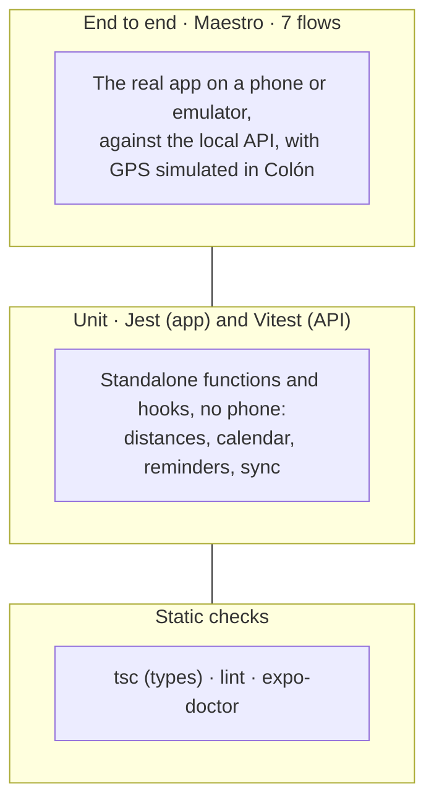
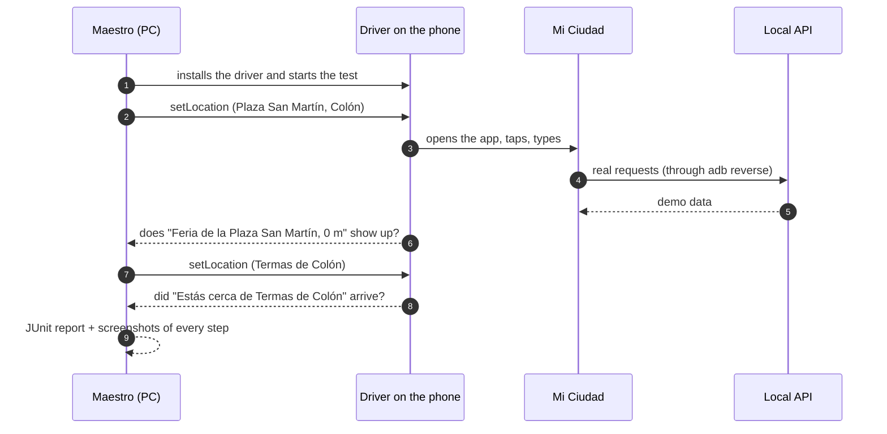

# Testing and quality

How the app is tested, what each test covers and how the course's minimum requirements are met.

## The test layers

| Layer | Tool | Where | How to run it |
|---|---|---|---|
| App unit tests | Jest | `MiCiudad/src/**/__tests__/` | `npm test` in `MiCiudad`, or **tests** in the playbook |
| API unit tests | Vitest | `api-mi-ciudad/test/` | `pnpm test` in `api-mi-ciudad` |
| End to end | Maestro | `MiCiudad/.maestro/` | **tests** → "Recorridos E2E" in the playbook |
| Static | TypeScript, ESLint, expo-doctor | all of `MiCiudad/` | `npx tsc --noEmit`, `npm run lint`, `npx expo-doctor` |

## App unit tests

They follow the Unit 2 convention: a `__tests__/` folder next to the code, `*-test.ts` files, and nothing inside `app/`, because Expo Router would treat every file there as a screen.

| File | What it checks |
|---|---|
| `compartido/distancia-test.ts` | Distance between two points (Haversine): 0 for the same point, the same both ways, and anything that rounds to 1000 m is already shown in km. |
| `compartido/zonaColon-test.ts` | Dates and times in Colón's time zone, not the phone's. |
| `compartido/sincronizadoEnEsteTelefono-test.ts` | Telling a "new phone" (copy the account's data) apart from "removed everything offline" (the phone wins). |
| `eventos/agenda-test.ts` | Grouping by Colón day, the folk night that crosses midnight (shown on both days), events with no end time or spanning several days, and finished events not showing. |
| `eventos/recordatorios-test.ts` | Reminder 60 min before; with less than an hour left, after 2 seconds; no permission, no reminder; nothing for started or non-scheduled events; a single notice when a saved event is suspended or cancelled. |
| `eventos/useEventos-test.ts` | The calendar and the event detail use the saved copy when offline. |
| `eventos/useEventoGuardado-test.ts` | What was removed offline does not come back when the network returns, and a new phone copies the account's saved events. |
| `eventos/BotonAvisarme-test.tsx` | If the reminder could not be saved, the button tells the person. |
| `mapa/proximidad-test.ts` | If the notice is turned off while the GPS is starting, the subscription is still stopped; and near a place without notification permission it only checks, without opening the permission prompt. |
| `mapa/useUbicacion-test.ts` | If the person declines the location accuracy prompt, it is not asked again and the map keeps the last known location. |
| `mapa/comoLlegar-test.ts` | Opens the route in Google Maps (Android) or Apple Maps (iPhone), walking or driving, and the screen does not break if the phone cannot open the map. |
| `mapa/rumbo-test.ts` | The compass arrow angle: always between 0 and 360, turns with where the phone points and crosses north without negative values. |

To avoid repeating test data, the tests share factories (`src/pruebas/fabricas.ts`) that build sample places and events.

## End-to-end flows (Maestro)

Maestro drives the real app like a person would: it taps, types, waits for text on screen and moves the GPS.

| # | Flow | What it checks |
|---|---|---|
| 01 | Map, filters and detail | Opens without an account with GPS at Plaza San Martín ("0 m"), filters by category, searches El Palmar and opens its detail with photo, hours and audio guide. |
| 02 | Searching places | Full list, search by name and the empty state ("No hay lugares que coincidan."). |
| 03 | Calendar and event | Days grouped, detail with when, where and price, and the Avisarme button. |
| 04 | Avisarme with an account | Avisarme asks for an account, then sign in and re-entry with fingerprint or password; saves the event with a reminder and removes it. |
| 05 | Offline | Airplane mode: the banner shows up, map and calendar keep the saved data, and when the network returns the banner goes away. |
| 06 | Proximity notice | Turning the notice on, off and on again leaves the app stable. |
| 07 | Notice on arrival in Colón | With the notice on and the app in the background, reaching the Termas triggers "Estás cerca de Termas de Colón". |

**Result (11/11/2026):** 7 out of 7 on a Motorola phone and on the emulator, on `develop35` and on the branch with the part C fixes.

## The course's 10 minimum requirements

| # | Requirement | How it is met | How it was verified |
|---|---|---|---|
| 1 | Screens and navigation with Expo Router | `src/app/` with tabs, stacks and dynamic routes (`lugar/[id]`, `evento/[id]`) | E2E 01 to 07 |
| 2 | Sign up, sign in, session that survives, token in SecureStore, fingerprint with a fallback | `SesionContext`, `secure-store.ts`, `biometria.ts`, Unlock screen | E2E 04, 06 and 07 |
| 3 | API behind our own services; loading, empty and error states on screen | `servicios/cliente.ts` (Axios) and one service per resource | E2E 02 (empty) and API down ("La API respondió 404." + Reintentar) |
| 4 | Camera or image-picker and the new expo-file-system | QR scanner, visit photo, `File` and `Paths` in downloads and photos | Code review |
| 5 | expo-location and react-native-maps, usable without permission | `useUbicacion`, map with markers | E2E 01 and 07 |
| 6 | Local notifications triggered by a real event | Proximity notice and event reminder | E2E 07 and 04 |
| 7 | SQLite, kv-store, opens offline and warns with expo-network | `db.ts`, kv-store, `BannerSinConexion` | E2E 05 |
| 8 | Sensors or haptics | Compass (expo-sensors) and haptics when registering a visit | Code review |
| 9 | Audio with visible controls | Audio guides with expo-audio | E2E 01 |
| 10 | 1024×1024 icon without transparency, splash and name | `assets/icon.png`, `expo-splash-screen` plugin, "Mi Ciudad Colón" | File review |
