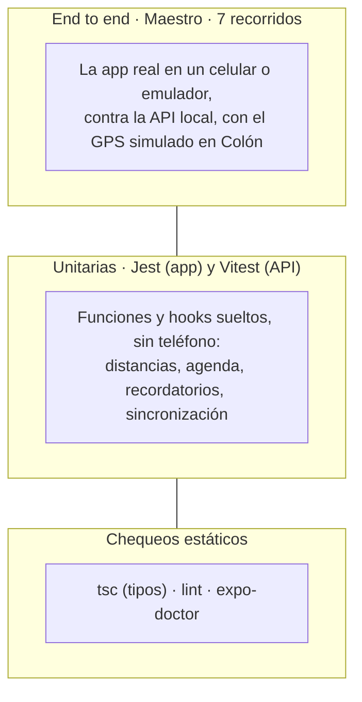
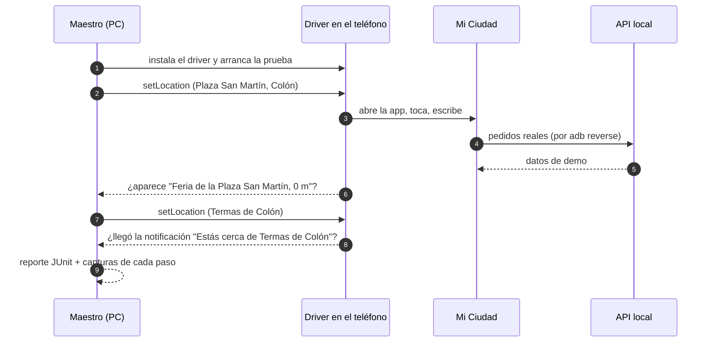

# Pruebas y calidad

Cómo se prueba la app, qué cubre cada prueba y cómo se cumplen los requisitos mínimos de la cátedra.

## Las capas de pruebas

| Capa | Herramienta | Dónde | Cómo se corre |
|---|---|---|---|
| Unitarias de la app | Jest | `MiCiudad/src/**/__tests__/` | `npm test` en `MiCiudad`, o **tests** en el playbook |
| Unitarias de la API | Vitest | `api-mi-ciudad/test/` | `pnpm test` en `api-mi-ciudad` |
| End to end | Maestro | `MiCiudad/.maestro/` | **tests** → "Recorridos E2E" en el playbook |
| Estáticos | TypeScript, ESLint, expo-doctor | todo `MiCiudad/` | `npx tsc --noEmit`, `npm run lint`, `npx expo-doctor` |

## Tests unitarios de la app

Siguen la convención de la Unidad 2: una carpeta `__tests__/` al lado del código, archivos `*-test.ts`, y nada dentro de `app/`, porque Expo Router trataría cada archivo como una pantalla.

| Archivo | Qué comprueba |
|---|---|
| `compartido/distancia-test.ts` | Distancia entre dos puntos (Haversine): da 0 en el mismo punto, es igual de ida que de vuelta, y lo que redondea a 1000 m ya se muestra en km. |
| `compartido/zonaColon-test.ts` | Fechas y horas con la hora de Colón, no la del teléfono. |
| `compartido/sincronizadoEnEsteTelefono-test.ts` | Distinguir un "teléfono nuevo" (copia lo de la cuenta) de "quitó todo sin red" (manda el teléfono). |
| `eventos/agenda-test.ts` | Agrupar por día de Colón, la peña que cruza la medianoche (aparece en los dos días), eventos sin hora de fin o de varios días, y que lo terminado no aparezca. |
| `eventos/recordatorios-test.ts` | Aviso 60 min antes; si falta menos de una hora, a los 2 segundos; sin permiso no agenda; no agenda eventos empezados o no programados; avisa una sola vez si un evento guardado se suspende o cancela. |
| `eventos/useEventos-test.ts` | La agenda y el detalle usan la copia guardada cuando no hay red. |
| `eventos/useEventoGuardado-test.ts` | Lo quitado sin red no reaparece al volver la red, y un teléfono nuevo copia los eventos guardados de la cuenta. |
| `eventos/BotonAvisarme-test.tsx` | Si no se pudo guardar el aviso, el botón se lo dice a la persona. |
| `mapa/proximidad-test.ts` | Si se apaga el aviso mientras arranca el GPS, la suscripción igual se corta; y cerca de un lugar sin permiso de avisos solo consulta, sin abrir el cartel del permiso. |
| `mapa/useUbicacion-test.ts` | Si la persona rechaza el cartel de precisión de ubicación, no se le vuelve a pedir y el mapa sigue con la última ubicación conocida. |
| `mapa/comoLlegar-test.ts` | Abre la ruta en Google Maps (Android) o Apple Maps (iPhone), a pie o en auto, y la pantalla no se rompe si el teléfono no puede abrir el mapa. |
| `mapa/rumbo-test.ts` | El ángulo de la flecha de la brújula: siempre entre 0 y 360, gira según hacia dónde mira el teléfono y cruza el norte sin valores negativos. |

Para no repetir datos de prueba, los tests comparten fábricas (`src/pruebas/fabricas.ts`) que arman lugares y eventos de ejemplo.

## Recorridos end to end (Maestro)

Maestro maneja la app de verdad, como una persona: toca, escribe, espera textos en pantalla y mueve el GPS.

| # | Recorrido | Qué comprueba |
|---|---|---|
| 01 | Mapa, filtros y ficha | Abre sin cuenta con el GPS en la Plaza San Martín ("0 m"), filtra por categoría, busca El Palmar y abre su ficha con foto, horarios y audioguía. |
| 02 | Buscar lugares | Lista completa, búsqueda por nombre y el estado vacío ("No hay lugares que coincidan."). |
| 03 | Agenda y evento | Días agrupados, detalle con Cuándo, Dónde y Precio, y el botón Avisarme. |
| 04 | Avisarme con cuenta | Avisarme pide cuenta, después ingreso y reingreso con huella o contraseña; guarda el evento con aviso y lo quita. |
| 05 | Sin conexión | Modo avión: aparece el banner, el mapa y la agenda siguen con lo guardado, y al volver la red el banner se va. |
| 06 | Aviso de proximidad | Prender, apagar y volver a prender el aviso deja la app estable. |
| 07 | Aviso al llegar a Colón | Con el aviso prendido y la app en segundo plano, llegar a las Termas dispara "Estás cerca de Termas de Colón". |

**Resultado (11/11/2026):** 7 de 7 en un celular Motorola y en el emulador, sobre `develop35` y sobre la rama con los arreglos de la parte C.

## Los 10 requisitos mínimos de la cátedra

| # | Requisito | Cómo se cumple | Cómo se verificó |
|---|---|---|---|
| 1 | Pantallas y navegación con Expo Router | `src/app/` con pestañas, pilas y rutas dinámicas (`lugar/[id]`, `evento/[id]`) | E2E 01 a 07 |
| 2 | Registro, ingreso, sesión que sobrevive, token en SecureStore, huella con alternativa | `SesionContext`, `secure-store.ts`, `biometria.ts`, pantalla Desbloquear | E2E 04, 06 y 07 |
| 3 | API detrás de servicios propios; carga, vacío y error en pantalla | `servicios/cliente.ts` (Axios) y un servicio por recurso | E2E 02 (vacío) y la API apagada ("La API respondió 404." + Reintentar) |
| 4 | Cámara o image-picker y el expo-file-system nuevo | Escáner QR, foto de la visita, `File` y `Paths` en descargas y fotos | Revisión de código |
| 5 | expo-location y react-native-maps, usable sin permiso | `useUbicacion`, mapa con marcadores | E2E 01 y 07 |
| 6 | Notificaciones locales por un hecho real | Aviso de proximidad y recordatorio de evento | E2E 07 y 04 |
| 7 | SQLite, kv-store, abre sin red y avisa con expo-network | `db.ts`, kv-store, `BannerSinConexion` | E2E 05 |
| 8 | Sensores o háptica | Brújula (expo-sensors) y háptica al registrar visita | Revisión de código |
| 9 | Audio con controles visibles | Audioguías con expo-audio | E2E 01 |
| 10 | Ícono 1024×1024 sin transparencia, splash y nombre | `assets/icon.png`, plugin `expo-splash-screen`, "Mi Ciudad Colón" | Revisión del archivo |
