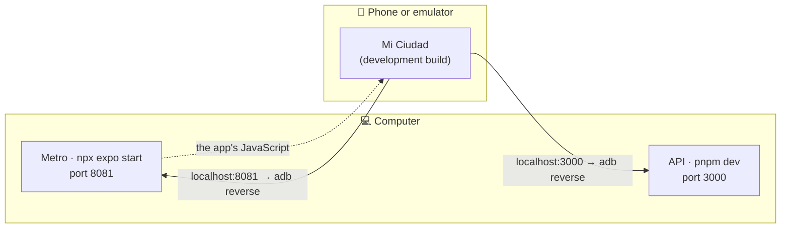
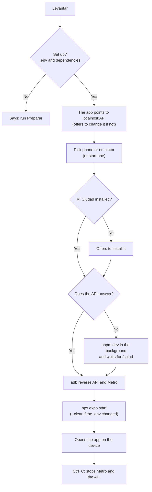

# Mi Ciudad Colón playbook

A menu that starts the project on your computer without remembering any command. It runs on **Windows and Linux** (also macOS). Every option shows what it runs behind the scenes, so you learn what a person would do by hand. The menu itself is in Spanish, like the rest of the team's tools.

## How to open it

| System | How |
|---|---|
| Windows | Double-click `playbook\playbook.cmd`, or in a terminal: `node playbook/playbook.ts` |
| Linux / macOS | `./playbook/playbook.sh`, or `node playbook/playbook.ts` |

It only needs **Node 24** (the same the API asks for). It installs nothing extra.

## The menu

| # | Option | What for |
|---|---|---|
| 1 | Revisar mi compu (check my computer) | Says what is missing (Node, pnpm, Java 17, Android, `.env`…) and how to install it. Changes nothing. |
| 2 | Preparar el proyecto (set up) | First time: `.env`, dependencies and demo data. |
| 3 | Levantar todo y abrir la app (start everything) | The everyday one: API + Metro + phone or emulator, and opens the app. Ctrl+C stops everything. |
| 4 | Instalar la app (install) | Builds and installs the development build, or installs an APK (for example the EAS preview). |
| 5 | Configurar el emulador (set up the emulator) | Creates one with the app's Android version and RAM and cores sized to your computer, adjusts an existing one or wipes its data. |
| 6 | Ver el celu en la compu (show the phone) | Opens the phone screen in a window, to share it during the defense. |
| 7 | Correr los tests (run the tests) | Jest (app), Vitest (API) and the Maestro end-to-end flows. |
| 8 | Volver los datos a cero (reset data) | Back to the demo data before a demo. |
| 9 | Ver la documentación (docs) | Opens all the project documentation in the browser. |
| 10 | Glosario (glossary) | What each command does and what it runs behind the scenes. |

## First time

1. **Revisar**: install whatever shows in red.
2. **Preparar**: it asks for the Google Maps key. Ask the team for it privately and never commit it.
3. Connect the phone over USB with **USB debugging** turned on, or create an emulator with **Configurar el emulador**.
4. **Instalar**: takes about 10 minutes the first time.
5. **Levantar**.

After that, every day: **Levantar**.

### For the defense

Run **Levantar** with the phone over USB and then **Ver el celu en la compu**; share that window in the video call. For the GPS in Colón:
- **Emulator:** the playbook sets it to Plaza San Martín on its own.
- **Phone:** you need a mock location app, such as Lockito.

## Without the menu

Each option can be run directly, for example:

```bash
node playbook/playbook.ts levantar
node playbook/playbook.ts revisar
node playbook/playbook.ts levantar --simular   # shows what it would do, changes nothing
```

Commands: `revisar`, `preparar`, `levantar`, `instalar`, `emulador`, `pantalla`, `tests`, `reiniciar`, `docs`, `glosario`.

## The recommended emulator

| What | Value | Why |
|---|---|---|
| Android | 16 (API 36), with Play Store | It is the version the app is built against. Preview versions fail for reasons unrelated to the code; Play Store is needed for Google Maps and mock-GPS apps. |
| RAM | 4 GB if the computer has 16 GB or more; 3 GB with 8 to 16 GB; 2 GB below that | With 2 GB Android stops responding; above 4 GB it takes memory away from Metro, the API and Gradle. Below 8 GB, a phone over USB is a better choice. |
| Cores | Half of the computer's, up to 4 | Enough for the emulator without slowing the rest. |
| CPU | x86_64 (Intel/AMD) or arm64 (Apple Silicon, Linux ARM) | So it runs with acceleration. |

The Android version of an existing emulator cannot be changed (it is tied to its image): to change it, create a new one.

## How the phone connects

The phone and the emulator see the API and Metro as `localhost`, thanks to `adb reverse` over the USB cable. That way they do not depend on Wi-Fi, the computer's IP or the firewall. That is why the app uses `EXPO_PUBLIC_URL_API=http://localhost:<API port>`.



This is what **Levantar** does, step by step:



To use the app **without a cable** (the preview APK against ngrok), follow the team's EAS preview README.

## Ports

- **API:** the `PUERTO` in `api-mi-ciudad/.env` (3000 by default).
- **Metro:** 8081 by default.

If another project already uses those ports on your computer, create `playbook/playbook.config.json`:

```json
{ "puertoMetro": 8035 }
```

That file belongs to your computer and is not committed. It also accepts `"repo"`, if you run the playbook from outside the repo.

## Common problems

| What happens | What to do |
|---|---|
| "No hay ningún celular conectado" | Turn on USB debugging, unplug and plug again, and accept the prompt on the phone. |
| The app says it cannot reach the API | Use **Levantar**: it runs `adb reverse` and points the `.env` to `localhost`. |
| The map is grey | The Google Maps key is missing in `MiCiudad/.env`. Run **Preparar**. |
| "Ya hay otra Mi Ciudad instalada con otra firma" | It is the preview APK. **Instalar** offers to uninstall it. |
| The API does not start | Check `playbook/registros/api.log`. |
| Building fails with a Java error | You need **Java 17** (and `JAVA_HOME` pointing to it). **Revisar** tells you how to install it. |

## How it is built

Object-oriented: each class has a single responsibility. Dependency-free TypeScript that Node 24 runs directly.

| Folder | What it holds |
|---|---|
| `playbook.ts` | Builds the pieces and wires them together. No logic of its own. |
| `Menu.ts` | The numbered menu. |
| `comandos/` | One class per option. All extend `Comando`, which holds the name, what it does and what it runs behind the scenes (in Spanish and English): the menu, the glossary and the documentation come from there. |
| `nucleo/` | `Consola` (print and ask), `Terminal` (run programs), `Plataforma` (Windows/Linux differences), `Proyecto` (paths and ports), `ArchivoEnv` (read and change a `.env` without printing values) and `Configuracion`. |
| `android/` | `Adb` (phone and emulator), `Emulador` (starting it), `Avd` (its settings), `HerramientasSdk` (sdkmanager and avdmanager), `RecomendacionEmulador` (values for your computer) and `SelectorDeDispositivo`. |
| `servicios/` | `Api`, `App`, `Metro`, `Java` and `PuenteTcp` (port forwarding for Windows). |
| `documentacion/` | `Markdown` (to HTML), `SitioDeDocumentacion` (collects the documents) and `PaginaHtml` (draws the page: index, language, theme and diagram viewer). |

To add an option: create a class in `comandos/` that extends `Comando` and register it in `playbook.ts`. It shows up on its own in the menu, the glossary and the documentation.
