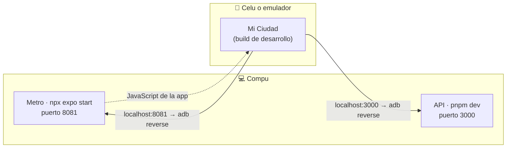
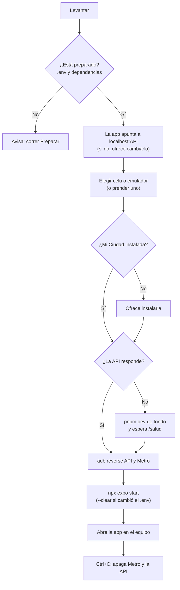

# Playbook de Mi Ciudad Colón

Un menú para levantar el proyecto en tu compu sin acordarte de ningún comando. Anda en **Windows y Linux** (también en macOS). Cada opción muestra lo que corre por detrás, así se aprende qué haría una persona a mano.

## Cómo se abre

| Sistema | Cómo |
|---|---|
| Windows | Doble clic en `playbook\playbook.cmd`, o en una terminal: `node playbook/playbook.ts` |
| Linux / macOS | `./playbook/playbook.sh`, o `node playbook/playbook.ts` |

Solo necesita **Node 24** (el mismo que pide la API). No instala nada extra.

## El menú

| # | Opción | Para qué |
|---|---|---|
| 1 | Revisar mi compu | Dice qué falta (Node, pnpm, Java 17, Android, `.env`…) y cómo instalarlo. No cambia nada. |
| 2 | Preparar el proyecto | La primera vez: `.env`, dependencias y datos de demo. |
| 3 | Levantar todo y abrir la app | El de todos los días: API + Metro + celu o emulador, y abre la app. Ctrl+C apaga todo. |
| 4 | Instalar la app | Compila e instala el build de desarrollo, o instala un APK (por ejemplo el preview de EAS). |
| 5 | Configurar el emulador | Lo crea con la versión de Android de la app y la RAM y los núcleos según tu compu, ajusta uno existente o le borra los datos. |
| 6 | Ver el celu en la compu | Abre la pantalla del celu en una ventana, para compartirla en la defensa. |
| 7 | Correr los tests | Jest (app), Vitest (API) y los recorridos E2E de Maestro. |
| 8 | Volver los datos a cero | Vuelve a los datos de demo antes de una demo. |
| 9 | Ver la documentación | Abre toda la documentación del proyecto en el navegador. |
| 10 | Glosario | Qué hace cada comando y qué corre por detrás. |

## Primera vez

1. **Revisar**: instalá lo que marque en rojo.
2. **Preparar**: te pide la clave de Google Maps. Pedísela al equipo por privado y nunca la subas al repo.
3. Conectá el celu por USB con la **depuración USB** activada, o creá un emulador con **Configurar el emulador**.
4. **Instalar**: la primera vez tarda unos 10 minutos.
5. **Levantar**.

Después, todos los días: **Levantar**.

### Para la defensa

**Levantar** con el celu por USB y después **Ver el celu en la compu**: se comparte esa ventana en la videollamada. Para el GPS en Colón:
- **Emulador:** el playbook lo pone en la Plaza San Martín solo.
- **Celular:** hace falta una app de ubicación simulada, como Lockito.

## Sin menú

Cada opción se corre directo, por ejemplo:

```bash
node playbook/playbook.ts levantar
node playbook/playbook.ts revisar
node playbook/playbook.ts levantar --simular   # muestra lo que haría, sin cambiar nada
```

Comandos: `revisar`, `preparar`, `levantar`, `instalar`, `emulador`, `pantalla`, `tests`, `reiniciar`, `docs`, `glosario`.

## El emulador recomendado

| Qué | Valor | Por qué |
|---|---|---|
| Android | 16 (API 36), con Play Store | Es la versión contra la que compila la app. Las versiones preview dan errores que no son del código; Play Store hace falta para Google Maps y las apps de GPS simulado. |
| RAM | 4 GB si la compu tiene 16 GB o más; 3 GB con 8 a 16 GB; 2 GB con menos | Con 2 GB Android "no responde"; con más de 4 GB le saca memoria a Metro, la API y Gradle. Con menos de 8 GB conviene el celu por USB. |
| Núcleos | La mitad de los de la compu, hasta 4 | Alcanza para el emulador sin frenar lo demás. |
| Procesador | x86_64 (Intel/AMD) o arm64 (Mac M, Linux ARM) | Para que corra con aceleración. |

La versión de Android no se cambia en un emulador que ya existe (va atada a su imagen): para cambiarla, se crea uno nuevo.

## Cómo se conecta el celu

El celu y el emulador ven la API y Metro como `localhost`, gracias a `adb reverse` por el cable USB. Así no dependen del wifi, la IP de la compu ni el firewall. Por eso la app usa `EXPO_PUBLIC_URL_API=http://localhost:<puerto de la API>`.



Esto es lo que hace **Levantar**, paso a paso:



Para usar la app **sin cable** (el APK preview contra ngrok), seguí el README de EAS preview del equipo.

## Puertos

- **API:** el `PUERTO` de `api-mi-ciudad/.env` (por defecto 3000).
- **Metro:** por defecto 8081.

Si en tu compu esos puertos están ocupados por otro proyecto, creá `playbook/playbook.config.json`:

```json
{ "puertoMetro": 8035 }
```

Ese archivo es de tu compu y no se sube. También acepta `"repo"`, si corrés el playbook desde fuera del repo.

## Problemas frecuentes

| Qué pasa | Qué hacer |
|---|---|
| "No hay ningún celular conectado" | Activá la depuración USB, desenchufá y enchufá, y aceptá el cartel en el celu. |
| La app dice que no hay conexión con la API | Usá **Levantar**: hace el `adb reverse` y deja el `.env` apuntando a `localhost`. |
| El mapa se ve gris | Falta la clave de Google Maps en `MiCiudad/.env`. Corré **Preparar**. |
| "Ya hay otra Mi Ciudad instalada con otra firma" | Es el APK preview. **Instalar** ofrece desinstalarlo. |
| La API no arranca | Mirá `playbook/registros/api.log`. |
| Compilar falla con un error de Java | Hace falta **Java 17** (y `JAVA_HOME` apuntando a él). **Revisar** te dice cómo instalarlo. |

## Cómo está armado

Programado con objetos: cada clase tiene una sola responsabilidad. TypeScript sin dependencias, que Node 24 corre directo.

| Carpeta | Qué tiene |
|---|---|
| `playbook.ts` | Arma las piezas y las conecta. No tiene lógica propia. |
| `Menu.ts` | El menú numerado. |
| `comandos/` | Una clase por opción. Todas heredan de `Comando`, que guarda el nombre, qué hace y qué corre por detrás: de ahí salen el menú, el glosario y la documentación. |
| `nucleo/` | `Consola` (escribir y preguntar), `Terminal` (correr programas), `Plataforma` (diferencias Windows/Linux), `Proyecto` (rutas y puertos), `ArchivoEnv` (leer y cambiar un `.env` sin mostrar valores) y `Configuracion`. |
| `android/` | `Adb` (celu y emulador), `Emulador` (prenderlo), `Avd` (su configuración), `HerramientasSdk` (sdkmanager y avdmanager), `RecomendacionEmulador` (valores según la compu) y `SelectorDeDispositivo`. |
| `servicios/` | `Api`, `App`, `Metro`, `Java` y `PuenteTcp` (reenvío de puertos para Windows). |
| `documentacion/` | `Markdown` (convierte a HTML), `SitioDeDocumentacion` (junta los documentos) y `PaginaHtml` (dibuja la página: índice, idioma, tema y visor de diagramas). |

Para agregar una opción: crear una clase en `comandos/` que extienda `Comando` y registrarla en `playbook.ts`. Aparece sola en el menú, el glosario y la documentación.
